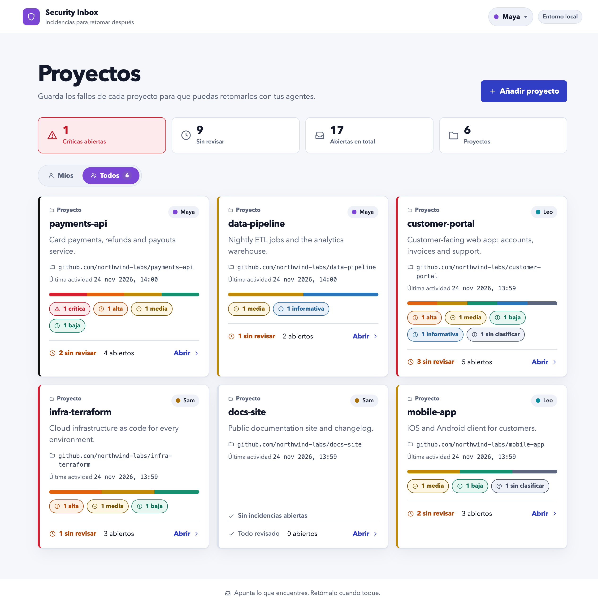
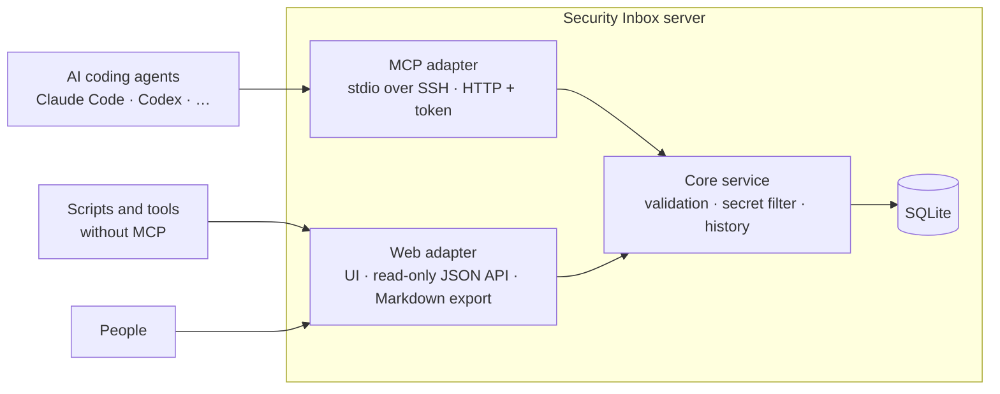
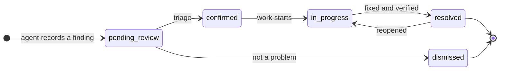

<h1 align="center">Security Inbox</h1>

<p align="center">
  <strong>A shared inbox where AI coding agents and their humans park the bugs and security issues they notice along the way,<br>so nothing found mid-task gets lost and fixing it stays a deliberate decision.</strong>
</p>

<p align="center">
  
  
  
  
  
  
</p>

<p align="center">
  <picture>
    <source media="(prefers-color-scheme: dark)" srcset="docs/images/overview-dark.png">
    
  </picture>
  <br>
  <sub>Project overview with synthetic demo data. The interface is in Spanish.</sub>
</p>

## Why it exists

Coding agents notice far more than the task they were given: a missing rate limit, an
unescaped field, a flaky test, a public bucket. Each such moment forces a bad choice.
Either the agent drifts off-task to fix something nobody asked for, or the observation
disappears when the session ends.

Security Inbox gives those observations a durable home. An agent records a title and a
sentence of context in one call, then goes back to its work. Later, a person or an
agent asked to "review pending work" picks the list up, with every change attributed
and kept in an append-only history.

## How it works



- **One service, two adapters.** The web UI and the [Model Context Protocol](https://modelcontextprotocol.io)
  server call the same core service. Validation, the secret filter and the history
  rules therefore apply the same way whichever door a change comes through.
- **Zero install for agents.** Clients connect to a central server over SSH (stdio) or
  over HTTP with a per-client token. No Node, database or repository is needed on the
  agent's machine.
- **One project per repository.** Projects are identified by their git remote,
  normalised (`git@github.com:acme/app.git` and `https://github.com/acme/app` are the
  same project, with any embedded credentials dropped). The same repository cloned on
  two laptops is still one project.

## The workflow



<sub>The usual path. Any status can move to any other; resolving or dismissing always needs a note.</sub>

1. **Capture without derailing.** While doing something else, an agent calls
   `register_finding` with a title and context; file, line, commit and evidence are
   optional. Severity starts as *unclassified* rather than a guess. A stable idempotency
   key makes retries return the same finding instead of a duplicate, and likely
   duplicates are flagged. Recording a finding never authorises fixing it.
2. **Triage later.** When asked, a person or an agent pages through `list_findings`.
   They confirm or dismiss, classify the severity, and link the finding to the ticket
   that will track it (`externalRef`, e.g. `PAY-311`).
3. **Fix and prove it.** Status moves through *in progress* to *resolved*. Closing
   requires a note with the verification: the test, the reproduction, the commit.
4. **Keep the record.** Every creation, edit, status change and note is stored
   append-only, together with the user who made it when one is configured. That
   attribution survives even if the user is later deleted.

The repository ships an [agent skill](skills/security-inbox/SKILL.md) that teaches agents
exactly this etiquette: check for duplicates, record, carry on, and close only with evidence.

## Features

| Area | What you get |
|---|---|
| **MCP server** | Ten tools to register, list, page through, read, update, annotate and close findings. Agents can also register projects and browse the server's folders. |
| **Web UI** | Project grid sorted by latest activity, severity bars, filters and pagination. Forms keep your draft when validation fails. Light and dark themes. |
| **Read access without MCP** | Read-only JSON API (`/api/projects…`) and a Markdown export per project. |
| **People** | Lightweight users for attribution: every project has an owner, and the history records who made each change. |
| **Secret filter** | Text that looks like a credential is rejected, never stored or echoed back: private keys, cloud and API tokens, `user:password@` URLs, `PASSWORD=…` assignments. |
| **Backups** | Consistent copies through SQLite's online backup API, each with a manifest (SHA-256, schema, row counts). Retention runs on a systemd timer, and restores only ever write to a new path. |
| **Migrations** | Five schema versions, each upgrade transactional and checked for foreign-key integrity. IDs, retry keys and history are preserved. |

## Security by design

The inbox stores exactly the kind of information an attacker would like to read, so it
is built defensively:

- **Strict browser policy.** Content Security Policy with `default-src 'none'`. No
  inline styles or scripts, no third-party assets: icons are inline SVG.
- **Request checks.** Every write must match an allowed Host and Origin and carry a CSRF
  token. An unknown Host gets a bare 403 that reveals nothing.
- **Minimal exposure by default.** The web UI listens on loopback unless an exact address
  and origin are configured. The container runs as an unprivileged user with read-only
  application code.
- **HTTP MCP tokens.** One token per client; only their SHA-256 digests are kept in
  memory. Path, Origin, token and declared size are checked before any body is read.
  A 1 MiB cap and request timeouts bound the rest.
- **Safe outputs.** The Markdown export is made inert: no raw HTML or link and image
  syntax can be smuggled through a finding, while bare URLs stay visible as text. The secret detector runs in linear time, so oversized
  input cannot stall the server.
- **An honest trust model.** There is deliberately no login: it is meant for a small team
  or a home lab behind a VPN, and users are *attribution, not authorisation*. That
  choice is documented rather than disguised.

The project eats its own cooking. Independent security audits and code reviews record
their findings in Security Inbox itself. Each fix closes its finding with the test that
proves it, and failing regression tests come first.

## Quick start

Requires Node.js 24.

```sh
git clone https://github.com/theBrokenCat/security-inbox.git
cd security-inbox
npm ci
npm run seed     # optional: synthetic demo projects and findings
npm run web      # http://127.0.0.1:3300
```

Connect an MCP client running on the same machine (for example Claude Code or Codex)
after `npm run build`:

```json
{
  "mcpServers": {
    "security-inbox": {
      "command": "node",
      "args": ["/path/to/security-inbox/dist/src/mcp/server.js"],
      "env": {
        "SECURITY_INBOX_DB": "/path/to/security-inbox/data/security-inbox.sqlite",
        "SECURITY_INBOX_USER": "demo"
      }
    }
  }
}
```

`SECURITY_INBOX_USER` is the slug of an existing user, created in the web UI. `demo`
exists after `npm run seed` on an empty database. That user becomes the author of
whatever the agent records.

For a shared server, Docker Compose runs the web UI and the MCP server. Remote agents
connect with `ssh -T <server> /path/to/security-inbox/scripts/mcp-stdio.sh`; that
launcher removes its container however the session ends. Setup, backups and
recovery are covered in the [guide](docs/guia.md) and the
[deployment notes](docs/deployment.md).

## Tech stack

**TypeScript** (strict) on **Node.js 24** · **Fastify 5** with **Nunjucks** templates and
hand-written CSS · **SQLite** through better-sqlite3 (WAL) · **Zod 4** validation ·
official **MCP TypeScript SDK** · **Vitest** · **Docker Compose** · POSIX shell for
operations.

```text
src/
├── core/       domain service, validation, secret filter, repository identity
├── storage/    SQLite schema and migrations, queries, backups
├── web/        Fastify app, read-only JSON API, Markdown export
├── mcp/        MCP server over stdio and streamable HTTP, client tokens
└── projects/   the only module that explores project folders
views/          Nunjucks templates
skills/         agent skill describing how to use the inbox
scripts/        stdio launcher, backups, end-to-end verification in Docker
test/           unit, migration, web, MCP end-to-end (stdio and HTTP) and script tests
```

## Quality

```sh
npm test            # Vitest: unit, migrations, web adapter, MCP end-to-end, shell scripts
npm run typecheck
npm run build
./scripts/verify-demo.sh   # builds the image and runs the whole flow in an isolated Compose project
```

- The MCP tests drive the real client over stdio and HTTP.
- Migration tests upgrade databases from older schemas and check that every row and
  event survives.
- The shell launcher is tested under both `dash` and `bash`.

## Documentation

| Document | Contents |
|---|---|
| [docs/guia.md](docs/guia.md) | Full user and operations guide *(Spanish)* |
| [docs/mcp-and-skill.md](docs/mcp-and-skill.md) | Connecting agents and installing the skill *(Spanish)* |
| [docs/deployment.md](docs/deployment.md) | Deployment, updates, backups and recovery *(Spanish)* |
| [AGENTS.md](AGENTS.md) | Architecture rules that coding agents must follow in this repository *(Spanish)* |

---

<p align="center">Built by <a href="https://github.com/theBrokenCat">theBrokenCat</a>.</p>
